# App Figurinha — Liga Aurora

App mobile (Android e iOS) para abrir pacotes, colecionar e trocar figurinhas
de jogadores de uma liga de futebol fictícia, a **Liga Aurora**.

## Telas

| Início | Abrindo pacote | Resumo do pacote |
|---|---|---|
| 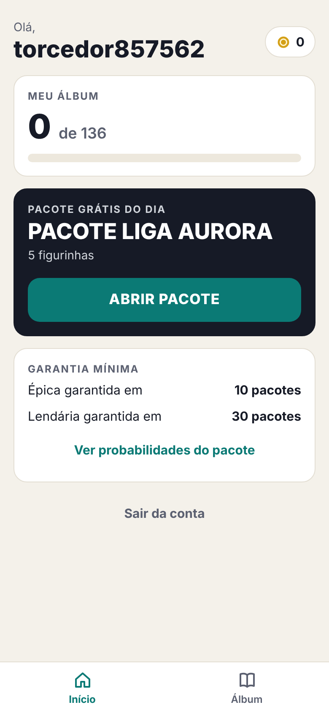 | 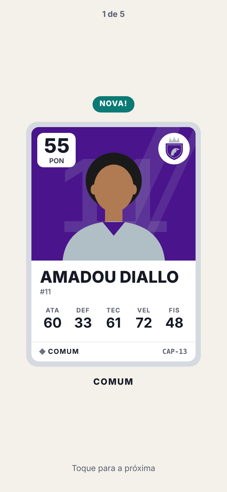 | 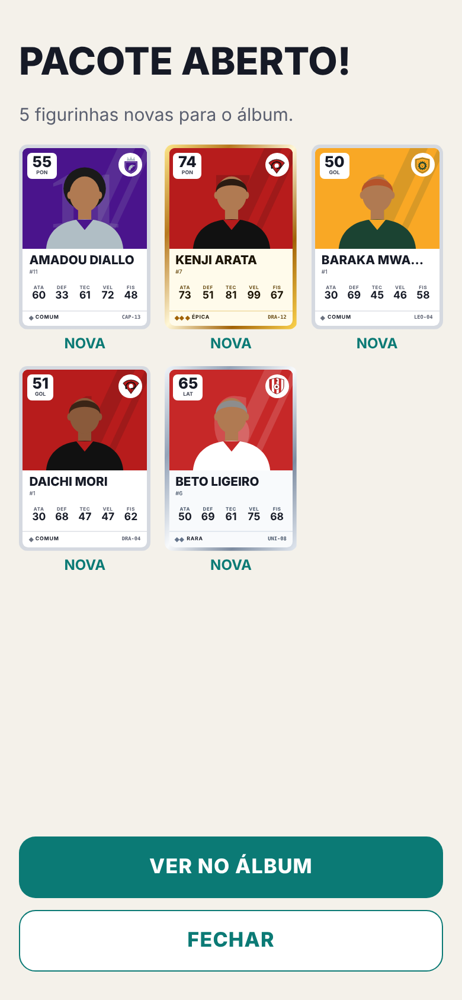 |

| Álbum | Detalhe | Probabilidades |
|---|---|---|
| 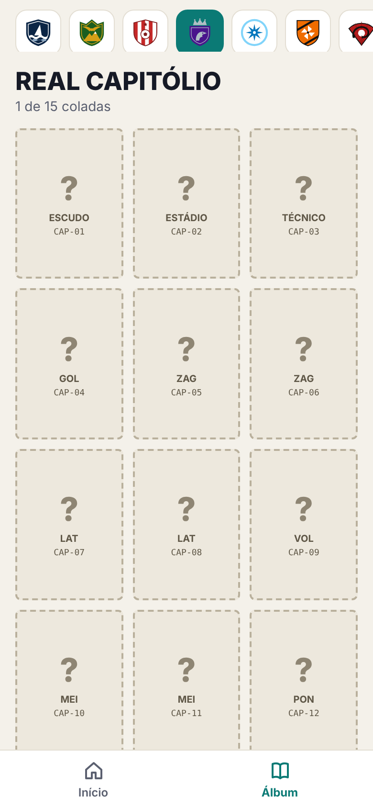 | 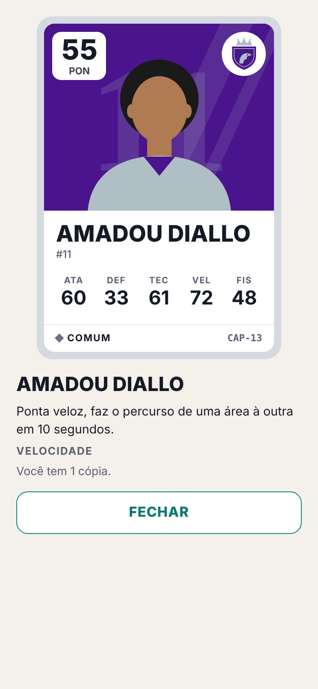 | 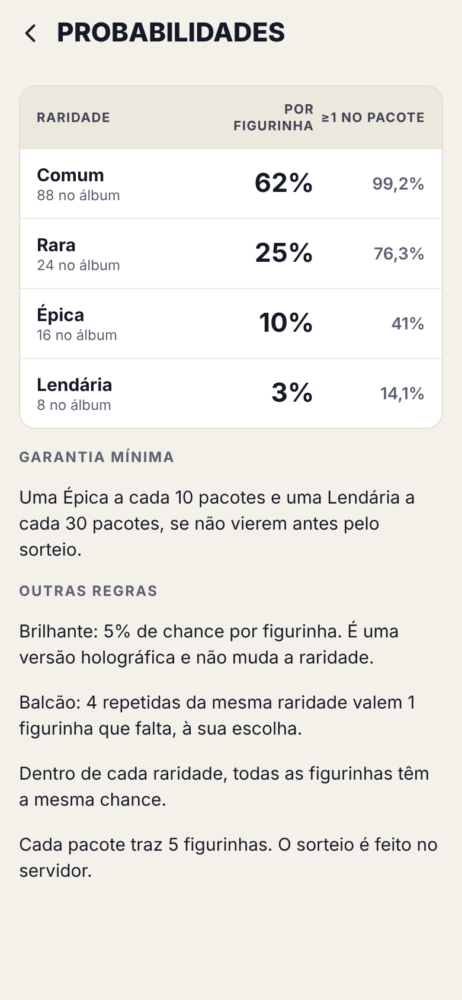 |

Avatares provisórios: a arte final dos jogadores ainda vai ser feita.

### Recompensas

| Página completa no balcão | Pacote de recompensa | Troféu do álbum completo |
|---|---|---|
| 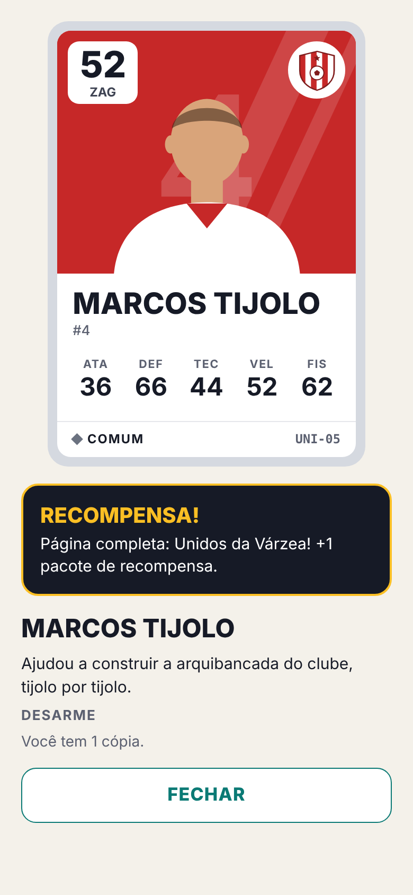 | 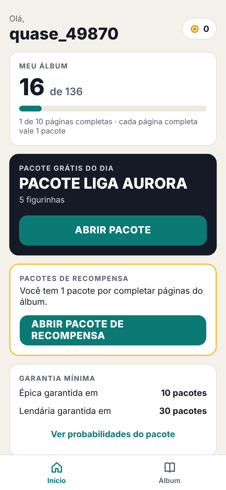 | 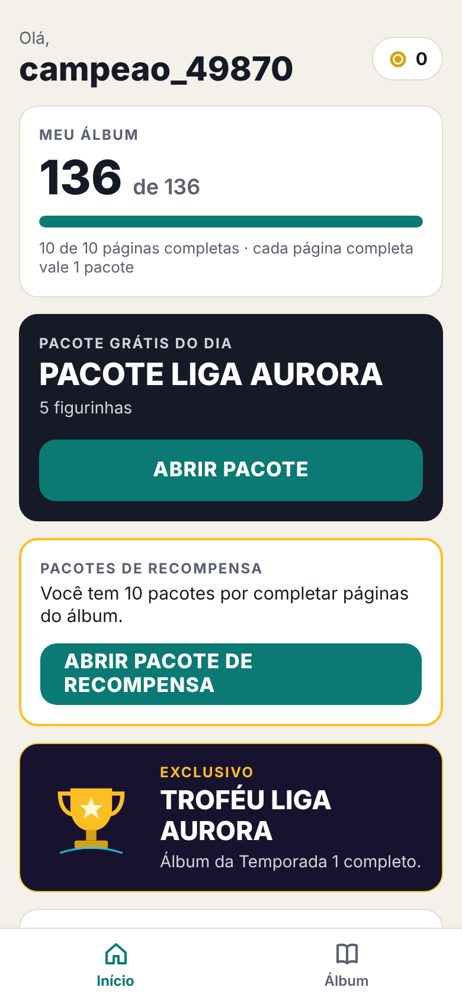 |

### Trocas entre amigos

| Mercado de repetidas | Montando a proposta | Proposta recebida |
|---|---|---|
| 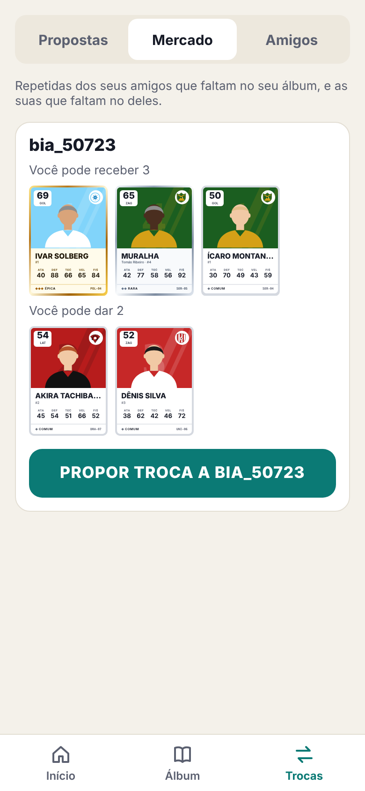 | 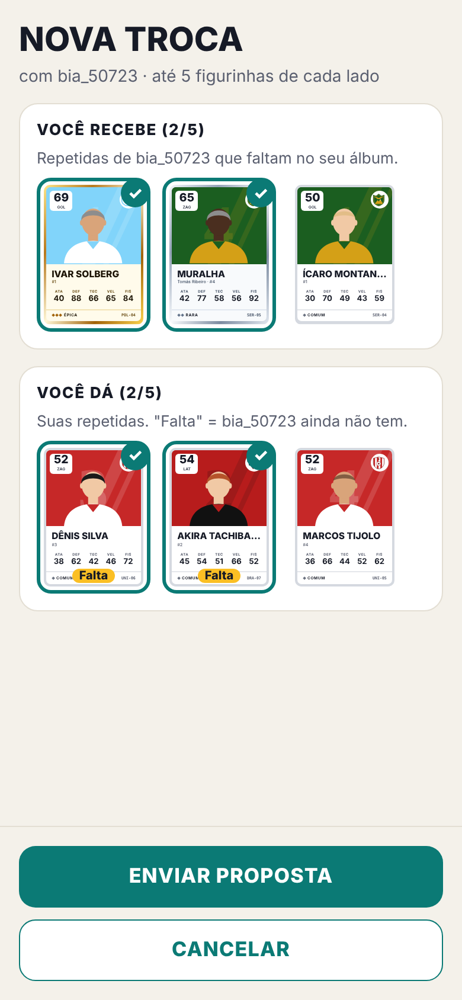 | 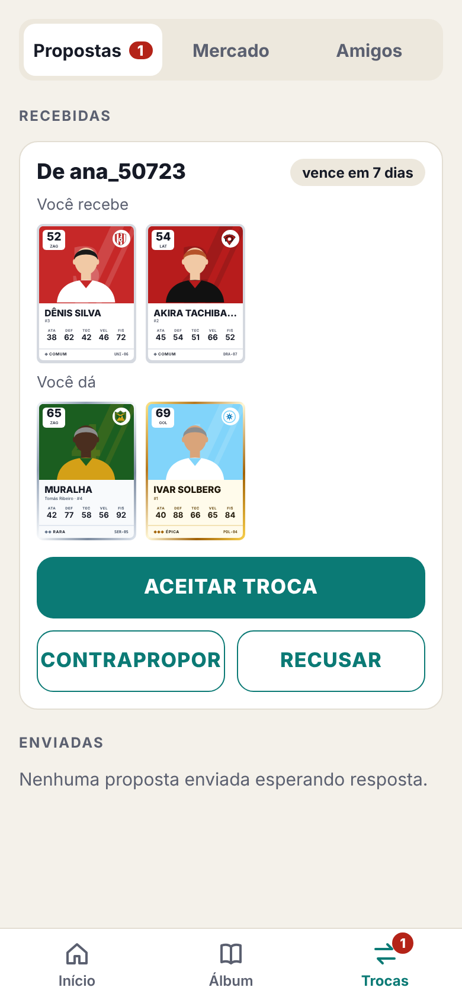 |

### Loja

| Ofertas e probabilidades | Compra concluída | Limite para menores |
|---|---|---|
| 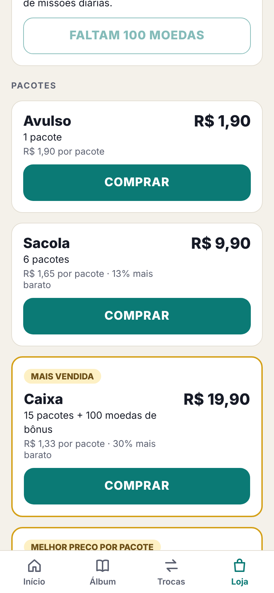 | 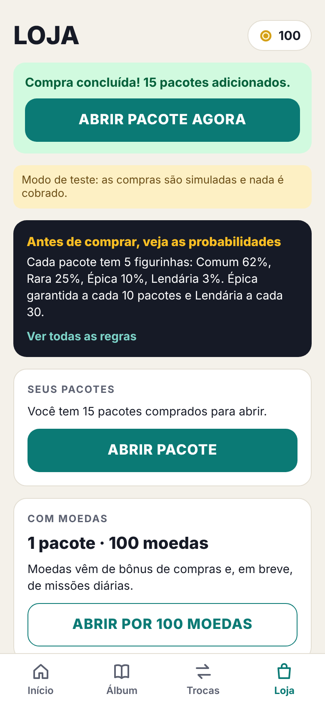 | 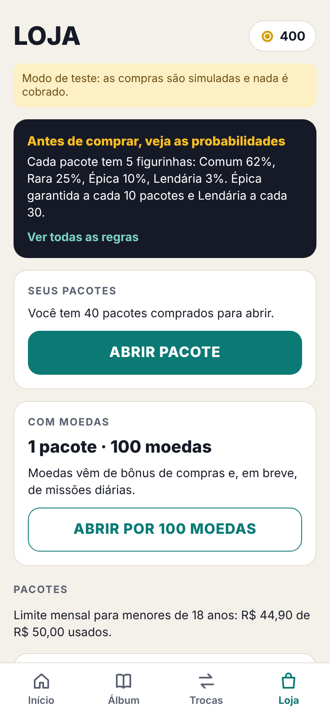 |

Pagamentos reais ainda não estão ligados: veja [docs/LOJA.md](docs/LOJA.md).

### Painel de administração (`/admin`)

| Resumo e conferência do sorteio | Edição de figurinha |
|---|---|
| 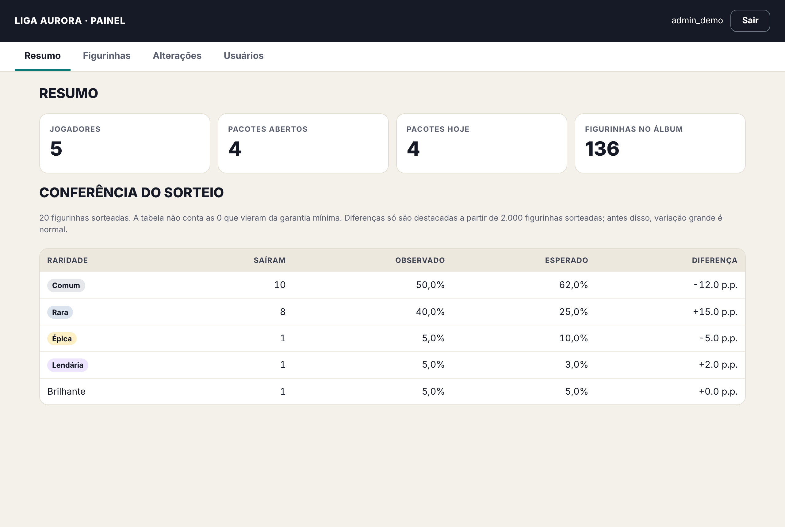 | 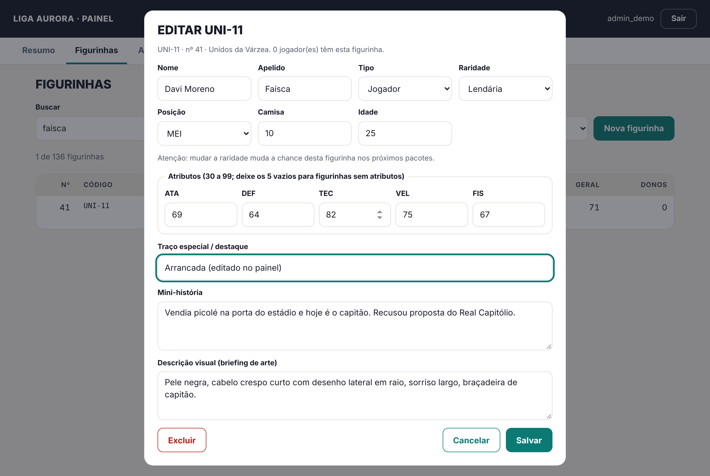 |

## Documentação

- [`docs/GAME_DESIGN.md`](docs/GAME_DESIGN.md): universo, álbum, raridades, economia, trocas e fases.
- [`docs/planilhas/`](docs/planilhas/): fichas das 136 figurinhas e simulação da economia.
- [`docs/LOJA.md`](docs/LOJA.md): loja, pagamentos e o que falta para cobrar de verdade.
- [`docs/arte/`](docs/arte/): plano e prompts da arte final (pendente).
- [`data/temporada1/`](data/temporada1/): os mesmos dados em JSON, usados como seed do banco.
- [`tools/planilhas/`](tools/planilhas/): scripts que geram as planilhas e o JSON.

## Estrutura

| Pasta | O que é |
|---|---|
| `apps/mobile` | App React Native (Expo, TypeScript); instalação própria, fora dos workspaces |
| `apps/api` | API NestJS + Prisma + PostgreSQL (sorteio dos pacotes, álbum, trocas) |
| `packages/regras` | Regras do jogo em TypeScript puro (sorteio, garantia mínima, balcão), com testes |
| `data/temporada1` | Clubes, figurinhas e parâmetros da economia |

## Começar

- API e banco: [`apps/api/README.md`](apps/api/README.md)
- App mobile: [`apps/mobile/README.md`](apps/mobile/README.md)

```bash
npm install && npm test   # regras do jogo (e API, se DATABASE_URL estiver definida)
```

## Atualizar os dados

Depois de mudar a planilha de fichas:

```bash
python3 -I tools/planilhas/exportar_json.py
```
